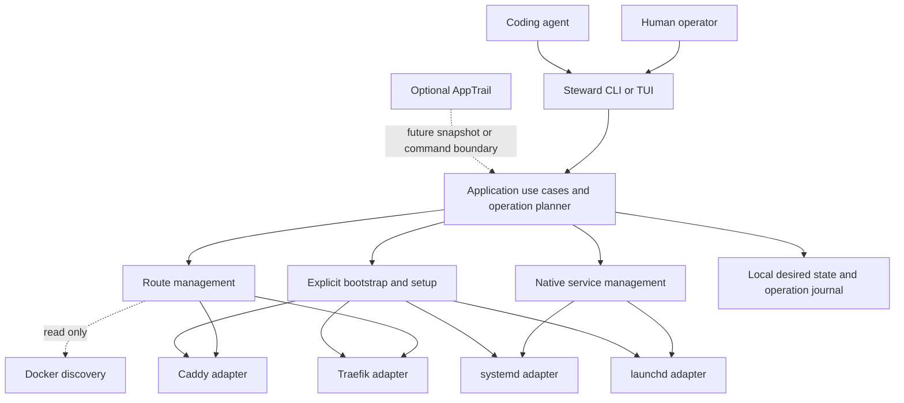
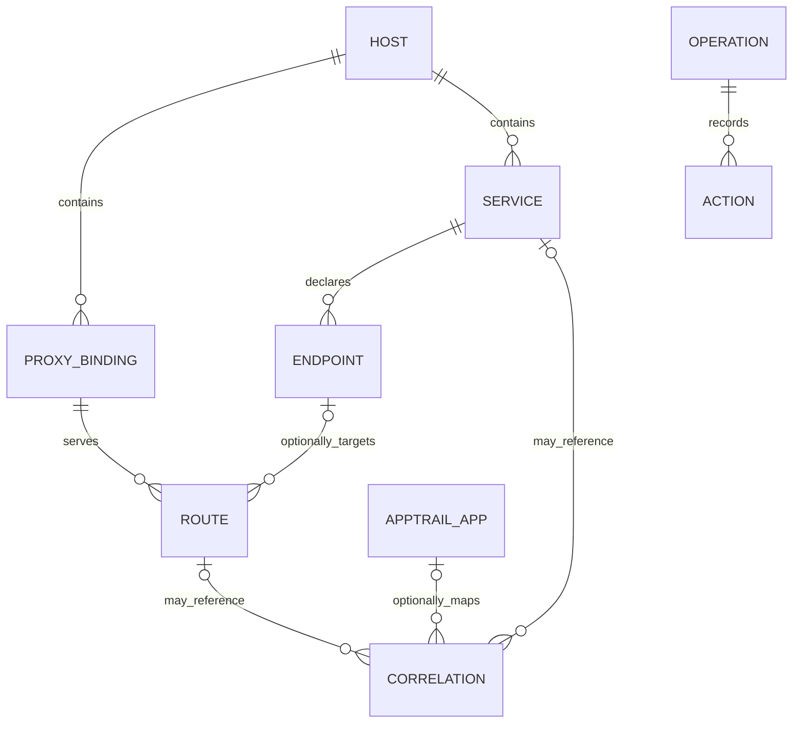
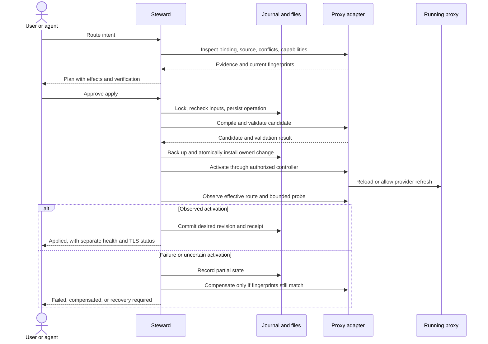
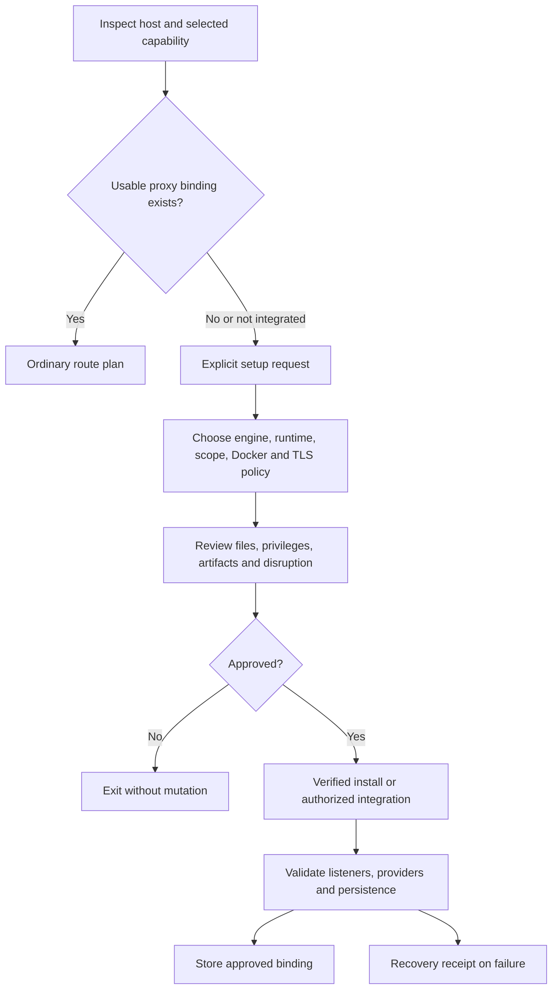

# Steward — Architecture and interaction design

**Status:** proposed implementation architecture, not an existing API.  
**See also:** [PRD](01_PRD.md), [implementation plan](03_IMPLEMENTATION_PLAN.md), [AppTrail integration](06_APPTRAIL_INTEGRATION.md), [references](07_VERIFIED_REFERENCES.md).

## 1. Runtime boundary: modules are not separate daemons

Ship one `steward` executable initially. CLI and TUI invoke the same application use cases. Service management and routing are separate internal modules, not separately deployed services. They cooperate only when the requested operation includes both.

After a command finishes, the long-running processes are the application's process, its native supervisor, and any installed proxy/controller. Steward is not in the HTTP request path and is not the parent supervisor responsible for keeping the application alive.



The arrows above are calls and data exchange, not mandatory network services. No internal module requires HTTP. The optional AppTrail edge is not an implemented endpoint.

## 2. Separate the axes that discovery often confuses

| Axis | Examples | Why it is separate |
|---|---|---|
| Proxy engine | Caddy, Traefik; Nginx later | Determines routing semantics and valid native configuration. |
| Configuration authority/controller | Plain Caddyfile, Caddy Docker controller, Traefik watched files, Docker labels, external JSON manager | Determines which source may safely produce the effective configuration. |
| Runtime | Native systemd unit, launchd job, Docker container, manually started process | Determines how startup changes or restarts can be applied. |
| Network context | Host network, container network, Docker Desktop VM, remote Docker daemon | Determines what an upstream address actually reaches. |
| Management scope | Current user, explicit system scope | Determines authority, file ownership, and native-manager targets. |
| Steward ownership | Owned definition, external observation, explicitly authorized lifecycle control | Determines which operations are allowed. |

Caddy running in Docker is not automatically `caddy-docker-proxy`. A discovered `Server` header is evidence at most, not proof of the engine, authoritative configuration, or listener owner. A binary existing on disk does not prove it is the active front-end.

An instance binding records these axes plus the evidence and confidence behind each. Explicitly approved bindings are reusable but revalidated when the runtime identity, config digest, version, or listener relationship changes.

## 3. Small workspace, modular adapters

The proposed Rust structure is intentionally modest. The repository may be standalone or a subtree of AppTrail after the audit; the module boundaries need not change.

```text
steward/
  crates/
    steward-core/
      model/             # resources, observations, capabilities, errors
      plan/              # pure diff, dependency ordering, policy
      use_cases/         # route, service, setup, composition
      ports/             # small interfaces consumed by use cases
    steward-adapters/
      proxies/caddy/
      proxies/traefik/
      discovery/docker/
      services/systemd/
      services/launchd/
      runtime/           # subprocess, scope, local filesystem, Docker runtime
      persistence/       # journal, receipts, locking
      installation/      # artifact resolution and verified extraction
    steward-cli/         # executable, command parsing, JSON output, wiring
    steward-tui/         # presentation and input; optional compile feature
  schemas/               # Steward-owned versioned JSON schemas
  fixtures/              # sanitized native configurations and API snapshots
  tests/
  docs/
```

Start with modules, not a separate crate per provider or per data type. A provider can be split into its own crate later when independent reuse, platform isolation, or dependency size justifies it. Do not create an AppTrail shared crate until actual call sites demonstrate genuine reuse.

Cargo workspaces allow independently built packages in one source tree. That does not settle whether the two products should share a repository. [S19] Clap and Ratatui are proposed CLI/TUI building blocks; confirm the selected versions and interfaces during foundation work. [S25, S26] Choose the remaining maintained libraries during the dependency review rather than importing an unnecessary framework.

User-authored configuration is YAML or JSON. Provider artifacts retain their native format: Caddyfile/JSON, Traefik YAML, systemd units, and launchd plists. Build-tool manifests are not the user configuration interface.

## 4. Domain model

### 4.1 Resources and observations

| Type | Minimum fields and behavior |
|---|---|
| `HostIdentity` | Stable local installation ID; OS/architecture; management scope. Cloned machines must regenerate host identity. |
| `ProxyBinding` | ID, engine/version, runtime reference, source/controller mode, authoritative config path, managed integration path, listener evidence, endpoint/auth references, capabilities, approval receipt. |
| `RouteSpec` | ID, exact hostname, upstream intent, proxy binding, enabled state, TLS policy, optional service endpoint reference and AppTrail correlation hint. |
| `ServiceSpec` | ID, executable and argument vector, working directory, manager/scope, startup/restart intent, environment, optional endpoints/readiness. |
| `EndpointSpec` | Named endpoint, scheme, bind-address intent, explicit port, optional readiness probe. It does not configure the application unless arguments/environment explicitly do so. |
| `RouteObservation` | Native ID, source, raw matcher reference, extracted hosts/targets where safe, runtime/config status, ownership, freshness, unresolved fields. |
| `ServiceObservation` | Native unit/job ID, manager and domain, loaded/running/startup state, last exit information, ownership/control permission, freshness. |
| `OperationPlan` | Operation ID, host/scope, input revision, provider fingerprints, ordered actions, effects, approvals, verification strategy, compensation limits. |
| `OperationReceipt` | Plan digest, action outcomes, before/after fingerprints, timestamps, redacted diagnostics, verification level, final/partial status. |

Do not reuse AppTrail's dashboard application object as `ServiceSpec`. A logical application may have multiple services and routes; a service may have no URL; a route may point to an external service; and an AppTrail entry may combine observations from all three.



### 4.2 Ownership and source identity

Ownership is established by a stored receipt plus the exact managed native ID/path and a fingerprint—not merely by a matching name prefix or comment. Namespaced native names are still useful for avoiding collisions.

For external resources, preserve a reference to the actual origin: for example, a Docker daemon ID/container ID/label key, a Traefik router name with its provider suffix, a Caddy route JSON pointer, or a file path and source range. Display transformed and native identities together.

`owned_definition`, `observed_external`, and `external_lifecycle_authorized` are distinct authorization states. Missing, stale, and drifted are observation states, not ownership states. Route source migration and service control authorization must not be conflated.

### 4.3 Capabilities rather than a giant common interface

Proposed ports are small and separate:

```text
ProxyDiscovery: inspect_binding, snapshot_routes
RouteCompiler: compile_owned_routes, validate_candidate
ProxyApplier: activate, observe_activation, compensate
ServiceManager: inspect, plan_definition, apply_definition, control, observe
BootstrapAdapter: inspect_setup, plan_setup, apply_setup, recover_setup
OperationStore: acquire_lock, begin, append_step, finish, load_recovery
```

These are conceptual Steward interfaces, not copied SDK signatures. Each result includes typed diagnostics and native detail. Pass timeouts/cancellation explicitly. Compilation and planning are deterministic and testable without live dependencies. Application requires an approved plan and cannot invent extra side effects.

Do not hide Caddy controller refresh, Traefik startup changes, systemd reload, and launchd job replacement behind a universal `reload()` that claims identical behavior.

## 5. Persistence and configuration

Proposed minimal persistence uses ordinary local files; SQLite is not required initially. The exact OS-specific root is resolved by scope and shown by diagnostics, not hardcoded to one user's home.

```text
config-root/
  config.yaml             # proxy bindings, policy, timeouts; secret references only
state-root/
  desired.yaml            # canonical managed-resource intent and revision
  ownership.json          # derived ownership receipts/index
  operations/<id>/
    plan.json
    events.jsonl          # write-ahead steps, fsynced at mutation boundaries
    receipt.json
    backups/              # scoped originals; restricted permissions
  generated/              # recovery material, not an alternative source of truth
  cache/                  # expendable observations
  lock                    # scope/integration-level mutation lock
```

`desired.yaml` is the single authoritative desired-resource document for that scope. Imported manifests are inputs to a plan, not an additional live configuration source. Generated native files are outputs. External configs remain authoritative for external resources.

An imported manifest upserts only the explicitly supplied resource IDs. An absent/empty resource collection leaves that capability unchanged; omitted resources are not deleted. Each supplied resource is a complete proposed spec for that ID, validated before planning. Deletion requires an explicit remove action. Do not introduce implicit pruning through `apply`; any future prune feature needs a bounded selector and separate destructive preview/approval.

Use a single scope-level writer lock initially. Shared system proxy integration paths also require a lock in the approved common integration root so two user installations cannot pretend to independently own the same output. Cross-scope combined requests are rejected initially unless an explicit coordinated implementation is added; no accidental root/user resource mixing.

Write a journal record containing old/new desired revisions before mutation. Stage candidate files outside watched locations, on the same filesystem where atomic replacement is needed. Preserve permissions; reject unsafe symlinks/path traversal; fsync file and directory as supported. Commit desired state and ownership only through the recoverable operation. A crash after native activation but before local commit is an **uncertain operation**, not grounds to repeat all steps blindly.

The journal is an implementation mechanism, not an event-sourcing platform. No broker, shared database, distributed lock, or permanent reconciliation service belongs in the initial architecture.

## 6. Route application and recovery



A file rename is not a distributed transaction with the running proxy. Verification is mandatory after publication. Traefik may already consume a new file before Steward records its final receipt. A controller can also change independently between snapshots. The journal and source fingerprints address recovery; they do not promise isolation from arbitrary third-party writers.

Suggested operation states are `planned`, `applying`, `verifying`, `succeeded`, `failed_before_change`, `partial`, `compensating`, `compensated`, and `recovery_required`. Cancellation before mutation is immediate. After mutation, finish a safe boundary, persist the situation, and compensate when authorized. Do not kill a critical native transition and return an unqualified cancellation.

### 6.1 Verification levels

Keep these separate: source written; controller accepted/observed; native route present; upstream reachable from proxy context; intended HTTP response observed; DNS points correctly; TLS issued/trusted. A 200 response from a catch-all route is not proof that the new route activated.

Prefer native route inventory plus a targeted Host/SNI probe and expected endpoint evidence. Where no admin/status channel is authorized, report the lower verification level explicitly. Never enable a public API just to upgrade diagnostics. If the backend cannot be observed, distinguish an intentionally allowed unhealthy backend from an unknown activation outcome.

### 6.2 Compensation rules

Restore only owned files or an explicitly authorized setup edit, and only if the current content still matches the operation's written content. Preserve changes made by another operator after the plan. Restore the matching native runtime state when safe; otherwise leave a recovery receipt and exact next action.

Do not replay an old whole-proxy configuration over a newer Docker-controller snapshot. Revert the managed input and let the authoritative controller rebuild from its current external sources.

## 7. Proxy adapter details

### 7.1 Ordinary Caddy with file-backed authority

Approved setup adds one import of a Steward-owned aggregate site file to the authoritative Caddyfile, after validating the integration location. Caddy imports are parsing-time inclusions; the import itself is not a file-watching daemon. [S02]

Normal application updates the owned aggregate, validates the effective candidate using the installed build/environment, and reloads the **complete authoritative configuration**, never the route fragment by itself. Caddy's command interface distinguishes adaptation from provisioning validation, and the latter can contend with resources held by a running instance. The adapter must classify those errors rather than declaring every validation failure a syntax error. [S03]

Treat a Caddy instance managed by an external JSON/API controller as a separate mode. Initial support may inventory it without writing. A future authorized JSON writer must define restart persistence and use applicable API concurrency controls; it cannot assume an unrelated Caddyfile is authoritative. Caddy documents ETag/If-Match coordination for `/config/...` mutations. [S24]

### 7.2 Caddy Docker controller

The Docker extension owns configuration synthesis. Steward contributes managed file content to that input; the extension remains the only writer of the effective complete proxy configuration. Its documented base-file option is `CADDY_DOCKER_CADDYFILE_PATH`. [S04]

Proposed safe integration: maintain an authorized, clearly delimited region containing actual generated route content in the configured base file, or use a wholly owned base when none exists. Preserve external bytes outside that region. Avoid making correctness depend on an imported leaf file changing while the controller sees an unchanged generated input. The exact refresh path is a release-blocking compatibility test, not an assumption.

The inspected generator reads the base file during generation; the loader has periodic regeneration and compares generated content before adaptation/application. These are observations of the inspected upstream branch, not a guarantee for every released build. [S05, S06]

During apply, publish the managed input and wait for a verified controller cycle. Do not manufacture Docker events or restart application containers to trigger refresh. Do not call `caddy reload` with only the base file, because it is not the complete Docker-derived configuration. Inspect that existing Docker routes remain present after both a managed-file change and a later real Docker event.

If a build/controller mode cannot safely accept and activate the managed input, report unsupported integration and keep it read-only until an explicit validated setup/migration is available. Polling latency is part of the UI and timeout budget.

### 7.3 Traefik file provider

Normal route writes use a dedicated aggregate YAML file under an already authorized watched directory. Namespace router/service IDs, distinguish `@file` from `@docker`, and preserve other files. Stage outside the watched directory and atomically replace the aggregate.

The official file-provider guidance recommends directory mode and mounting the parent directory for containerized deployments because renaming an individually bind-mounted file can break updates. Test the chosen filesystem/mount, including removal of the last route. [S07]

Setup must inspect whether startup settings originate in a file, CLI arguments, or environment. Do not write a YAML file and assume it overrides command-line settings. Existing `filename` mode, missing directory mounts, entrypoints, or absent certificate resolvers require a reviewed setup change rather than an ordinary route operation. [S01]

The API is a read/diagnostic channel for Steward, not a generic route-write API. It can provide routers, services, and configuration/error information when enabled and authorized. [S11] Do not invent a universal `traefik validate` command. Use schema/semantic checks, isolated candidate testing where possible, and runtime observation against the pinned version. Document any limitation of preflight validation.

For newly provisioned Docker discovery, propose `exposedByDefault: false` so publishing is opt-in. Never change an existing installation's setting silently, since it changes externally managed behavior. [S10]

## 8. Network and hostname resolution

`127.0.0.1` belongs to the process's network context. A host-local upstream is not interchangeable with a loopback address inside the proxy container. Docker Desktop documents `host.docker.internal` for reaching the host, while Linux Engine can explicitly map a host-gateway address. Neither guarantees access to an application bound only to a different interface. [S12, S22]

Represent upstream intent separately from the concrete rendered address:

| Intent | Candidate resolution | Must verify |
|---|---|---|
| Host endpoint, native proxy | Host address and explicit port | Correct host, bind interface, address family, actual listener. |
| Host endpoint, container proxy | Approved host-access mapping | Runtime-specific routing, firewall, and application bind reachability. |
| Container endpoint, container proxy | Stable DNS/service alias on a shared network | Both memberships, namespace, selected internal port. |
| Container endpoint, native proxy | Stable published host endpoint or explicit reachable address | Published versus exposed port; Docker daemon may be remote. |
| External endpoint | Explicit URL | Allowed destination, TLS verification, proxy network reachability. |

No automatic fallback to `0.0.0.0`, network attachment, host-network mode, port publication, or disabled TLS verification. Those are separate application/infrastructure changes. With a remote Docker daemon, the local machine is not implicitly that daemon's host; initially reject write plans that depend on this ambiguity.

Resolve hostnames for diagnostics only. Steward does not register public DNS or silently edit `/etc/hosts`. Listener inventory includes IP family and bind address, not just the numbers 80 and 443. Multiple active proxies or an upstream load balancer may require an explicit binding; automatic discovery is not a global topology oracle.

## 9. Service adapters

### 9.1 Portable intent, native truth

Maintain separate fields for definition existence, registration/loading, running state, startup intent, restart policy, and observed health. A command's immediate runtime intent is not a permanent policy enforced by a Steward daemon. For example, stop can leave startup enabled for the next login/boot; a later explicit apply reconciles the manifest again.

| User operation | Portable intent | Important constraint |
|---|---|---|
| Add/create | Record/render a managed definition | No automatic route or implicit start. |
| Start/stop | Change immediate running state | Preserve startup intent; stop must counter the manager's own relaunch behavior. |
| Enable/disable | Change startup policy | Surface any backend-specific registration effects; `--now` explicitly also requests runtime change. |
| Restart | Stop then start | Disruptive; not the same as reload. |
| Reload | Ask application/manager for supported in-place reload | Capability-gated; never silently replaced with restart. |
| Edit | Replace owned definition and reconcile | Show required reload/re-registration/restart. |
| Remove | Remove owned registration and definition | Attached-route dependency check; preserve app data. |

### 9.2 systemd

Render a managed unit with an explicit executable/arguments, working directory, restart policy, and configured user identity where applicable. Distinguish user and system managers. Use machine-oriented state reads rather than scraping the colored human `status` display.

Unit-file changes require manager reload as appropriate; enablement and current running state are different. A user manager's lifetime across logout/boot must be checked, and enabling linger is a separate permission-bearing setup action. [S13, S14, S15]

Argument escaping, `%` expansion, environment substitution, and native service directives are not generic shell syntax. Unit rendering must use fixtures for hostile arguments and the selected native validation path. Do not pass a user command through a shell by default. [S14, S17]

### 9.3 launchd

Render a managed plist with a stable label, argument vector, working directory, appropriate restart/startup intent, and explicit logging destinations. User agents and system daemons are different scopes; SSH sessions do not prove a GUI domain is available. Do not install into Apple's `/System/Library` locations. [S16, S27]

Implementation must verify domain-targeted `launchctl` operations and their exact semantics using the target machine's `man launchctl`, `man launchd.plist`, and reproducible tests. Plan for bootstrap/bootout, explicit enablement, and restart behavior where supported; do not assume `kill` means “stopped” under KeepAlive, or that rewriting a plist replaces a loaded job.

Represent any weaker restart/delay semantics honestly. Do not promise systemd-equivalent backoff, dependency ordering, or environment-file behavior. Launchd does not become an implicit shell: version-manager shell hooks are not a valid executable-resolution strategy.

### 9.4 Environment and privileges

Portable V1 supports explicit environment values, with secret-bearing fields protected and redacted. Never copy the entire interactive environment by default. First-release examples contain no secrets. Native environment-file support is capability-specific; a portable secret-file wrapper would be a separately tested feature, not a hidden promise of the service model.

Use normal OS authorization for system actions. A privileged execution path must revalidate the approved plan and trusted paths; it cannot accept an arbitrary user-writable plan as blanket permission for root execution. Keep discovery unprivileged where possible. A system-owned service should run the application as an explicit non-root identity unless root is genuinely required and approved.

## 10. Composition, dependencies, and lifecycle

```mermaid
sequenceDiagram
    actor U as User or agent
    participant S as Steward composition
    participant M as Native service manager
    participant A as Application
    participant P as Proxy adapter
    U->>S: Up service with route
    S->>S: Preflight both sides, journal one operation
    S->>M: Install or update owned service definition
    S->>M: Start service
    M->>A: Run foreground executable
    S->>A: Bounded readiness check
    alt Application ready
        S->>P: Publish route and verify activation
        alt Route activated
            S-->>U: Service running and route applied
        else Route failed
            S->>P: Revert owned route input if safe
            S-->>U: Partial result; service retained by default
        end
    else Not ready
        S-->>U: No route published; service failure details
    end
    Note over M,A: Application remains supervised after Steward exits
```

The service endpoint reference is an explicit dependency. A route can point to an unmanaged endpoint without any service reference. Editing a managed endpoint's port proposes corresponding route changes only for explicitly linked resources; it must not infer relationships from matching numbers.

A successfully created service retained after route failure must be committed as an owned resource with its successful desired-state change and a partial operation receipt. Do not leave an untracked native job merely because the combined operation failed. A compensated route keeps its prior canonical intent; the rejected/pending request and diagnostics remain in the operation journal rather than being mislabeled as applied.

Default combined down order is disable the owned route, observe the routing change, then stop the managed service. Service removal with attached routes is blocked unless a cascade/detach plan is explicitly approved. A routes-only disable does not stop the service; a service-only stop warns about attached routes but does not modify them.

Readiness-before-publication is a one-time operation guarantee. After reboot, the proxy and service may start in a different order, and after a later crash Steward does not automatically retract routes. Native restart and proxy health behaviors apply. Continuous health-driven route suppression would require an explicitly introduced controller and is not promised here.

## 11. Bootstrap and installers



Install a version-pinned artifact into a Steward-owned versioned location when provisioning new binaries. Caddy with Docker support requires a build containing that extension; a downloaded plugin file is not enough. Preserve required existing Caddy modules when integrating with an installation; do not overwrite a package-manager binary blindly. [S04, S23]

Choose native versus container runtime explicitly. For native Caddy with no usable Docker daemon, run in ordinary file mode even if the installed build includes the extension; do not launch a Docker-dependent controller and hope it works. For new container proxies, persist certificate/config state and mount managed directories correctly. No Docker installation is implied.

The installer verifies publisher provenance where available and always verifies declared digests; a checksum obtained from the same untrusted location alone is not a complete trust model. The artifact manifest records engine/plugin versions, OS/architecture, source, signature policy, and license notices. Custom Caddy builds may be produced in CI so users do not need a Go toolchain. Availability of those artifacts is a required implementation deliverable, not something this document assumes already exists.

Upgrade and uninstall are explicit. Uninstall removes only Steward-owned artifacts/bindings and preserves proxy certificate data by default. Package-manager-owned files, user configuration, and unrelated routes are never removed.

## 12. CLI contract and AppTrail boundary

Proposed examples, to implement and test:

```sh
steward proxy list --json
steward proxy setup --engine traefik --runtime native --scope system
steward route add api --hostname api.example.com --upstream http://127.0.0.1:3000 --proxy edge --dry-run
steward route add api --hostname api.example.com --upstream http://127.0.0.1:3000 --proxy edge --yes
steward service add worker --scope user --working-directory /srv/worker -- /usr/local/bin/worker
steward service start worker --yes
steward plan --file ./steward.yaml --out ./plan.json
steward apply --plan ./plan.json --yes --json
steward operation inspect OPERATION_ID --json
steward doctor --json
```

`--yes` confirms a described ordinary operation; it never changes a route command into setup, bypasses stale-plan checks, or grants new privileges. Setup acceptance belongs to an explicitly selected setup operation. `--dry-run` avoids externally visible mutation; local planning caches must not be confused with native config changes.

Proposed result envelope:

```json
{
  "schema_version": "1",
  "operation_id": "op_example",
  "status": "partial",
  "changed": true,
  "resources": [
    {"kind": "service", "id": "api", "state": "running"},
    {"kind": "route", "id": "api-public", "state": "not_activated"}
  ],
  "errors": [{"code": "proxy.activation_timeout", "retryable": false}],
  "next_action": "Inspect the operation receipt before retrying."
}
```

Use stable scoped error codes such as `setup.required`, `ownership.external`, `discovery.ambiguous`, `plan.stale`, `network.unreachable_from_proxy`, `capability.unsupported`, and `operation.recovery_required`. Propose a small stable exit-code table during CLI implementation; JSON is the detailed contract, not error-message text.

Future AppTrail integration should begin with independent discovery or versioned exported snapshots. A local CLI/subprocess boundary can add authorized operations later. No shared database, common mandatory daemon, or generic remote shell is required. The repository audit and integration contract are separate decisions; see [06_APPTRAIL_INTEGRATION.md](06_APPTRAIL_INTEGRATION.md).
