# Steward — Implementation plan

**Status:** proposed, dependency-ordered execution plan.  
**First owner:** the existing AppTrail agent, which must complete the repository investigation before delegating implementation.  
**Definition of done:** implemented behavior plus reproducible verification and documentation—not a checklist marked complete from static reasoning.

## 1. Execution rules

The accepted product constraints in the PRD take precedence over a convenient implementation shortcut. Internal designs in this pack can evolve, but changed assumptions must be recorded. A library interface, native command, or integration behavior that differs from this plan must be checked against the installed version and primary documentation.

When a discrepancy affects product behavior, security, persistence, ownership, platform support, repository placement, or required dependencies, pause the affected task and report: the assumption; the exact observed behavior; source/test evidence; the impact; and the smallest viable options. Continue independent work only where it cannot bake in the disputed assumption. Do not silently drop the capability or replace it with a disruptive fallback.

Use short vertical slices. Avoid implementing a generic provider framework before one real route works end to end. Nevertheless, ownership, explicit setup, and journaled mutation are foundational, not optional hardening after a prototype writes live configurations.

## 2. Milestone dependency chart

```mermaid
flowchart LR
    M0[M0 AppTrail audit and repository decision] --> M1[M1 Compatibility spikes and contracts]
    M1 --> M2[M2 Core, CLI, state and operation engine]
    M2 --> M3[M3 Inventory and approved bindings]
    M3 --> M4[M4 Caddy route adapters]
    M3 --> M5[M5 Traefik route adapter]
    M4 --> M6[M6 Explicit bootstrap and installers]
    M5 --> M6
    M6 --> M7[M7 TUI and proxy release hardening]
    M7 --> R1[Proxy-management release]
    R1 --> M8[M8 Native services]
    M8 --> M9[M9 Combined service and route operations]
    M9 --> R2[Services and composition release]
    R2 --> M10[M10 Optional AppTrail integration]
    R2 --> Later[Later adapters and platforms]
```

Minimal native runtime adapters can be built during M1/M6 to start a provisioned proxy. M8 expands them into the general user-facing service feature set. This avoids inventing a separate background-start mechanism for the proxy release.

## 3. M0 — AppTrail audit and placement decision

### Work

Read [04_APPTRAIL_AGENT_HANDOFF.md](04_APPTRAIL_AGENT_HANDOFF.md), inspect the current AppTrail code, and fill the repository decision record. Map actual Docker/Caddy/Traefik call sites, types, state dependencies, credential handling, runtime assumptions, tests, build system, and release workflow.

Evaluate reuse at function/module level. Shared upstream vendors are not evidence of shared behavior. The agent may choose one repository with zero shared production code where tooling benefits justify it, but must not sell that as functional reuse. Assess a genuinely separate repository on equal terms.

### Deliverables

`REPOSITORY_DECISION.md` with the audited commit, a reuse matrix, rejected abstractions, selected topology, and release implications. When selecting a separate repository, also complete `APPTRAIL_TECHNICAL_TRANSFER.md` and include sanitized fixtures and a reproducible smoke-test guide. Templates are supplied in this pack.

### Exit gate

A new coding agent can identify the selected workspace and proceed without guessing AppTrail interfaces. No shared crate has been extracted simply because both tools use Docker, Caddy, or Traefik. The user's concern about unnecessary abstraction is explicitly addressed.

## 4. M1 — Compatibility spikes and contract freeze

Do these as disposable experiments with pinned binaries/images and a written result. Production machines are not the test harness. Record OS, engine/controller versions, installation mode, commands, configuration, expected result, observed result, and upstream reference.

| Spike | Question to resolve | Required outcome |
|---|---|---|
| Caddy file integration | Can a managed aggregate be imported while preserving external sites and matching the running environment? | Full-config validation/reload and rollback demonstrated. |
| Caddy Docker controller | Does changing only the managed base contribution activate without a Docker event, and do label routes persist afterwards? | Proven refresh trigger/latency, source version, and controller-mode limits. |
| Traefik file integration | Does an aggregate change, atomic replacement, and final-route removal converge on the selected mounts? | Parent-directory mount recipe and verified activation method. |
| Traefik setup | How are startup file/CLI/environment authority and existing filename mode handled? | No imagined merge precedence or validation command. |
| Host/container networking | Which stable upstream mappings actually work on Linux and Docker Desktop? | Explicit supported recipes and blocked cases. |
| Native bootstrap | How are a proxy's lifecycle and configuration registered on systemd and launchd? | Scope, permissions, persistent paths, and removal validated. |
| Install artifacts | Can each chosen architecture get a trusted Caddy Docker build or Traefik artifact? | Versioned source/provenance matrix; CI custom build where needed. |
| CLI/result schema | What exact inputs, error codes, state transitions, and plan approvals are needed? | Versioned JSON contracts and readable YAML examples. |

Freeze the first writable route subset, resource identity rules, result envelope, and state layout after these spikes. A failed spike becomes a documented blocker or a revised design proposal, not a guessed implementation.

### Exit gate

All critical assumptions have evidence or a clearly marked blocked capability. Both initial engines remain in the proxy release scope. Any material support reduction is brought back to the user.

## 5. M2 — Core, CLI, and mutation foundation

### Work packages

| Package | Implementation | Required checks |
|---|---|---|
| Domain types | Resource IDs, specs/observations, ownership, capabilities, typed diagnostics. | Invalid IDs and ambiguous states cannot pass validation. |
| Configuration | YAML/JSON parsing, JSON schemas, version handling, scope/path resolution. | Reject duplicate keys, invalid fields, unsupported major versions, and dangerous paths. |
| Planner | Desired/observed diff, idempotency, source fingerprints, dependency ordering, risk descriptions. | Stable output from identical inputs; no live mutation. |
| Operation store | Writer lock, journal, backups, receipts, recovery inspection. | Crash at every mutation boundary is classifiable. |
| Filesystem backend | Safe staging, atomic replacement, ownership/permissions, restricted backup access. | Symlink/race/failure tests and cross-filesystem refusal. |
| Command execution | Executable-plus-argv, timeouts, cancellation, redacted output, privilege boundary. | No shell injection, unbounded subprocesses, or accidental root context. |
| CLI | Help, `plan`, `apply`, diagnostics, JSON output, noninteractive rules. | No prompts or TUI output in agent mode; stderr/stdout separation. |

Build a fake proxy and service adapter only to exercise the operation engine. They must not become a substitute for live integration tests.

### Deliverables

Buildable Steward workspace; initial CLI; versioned schemas; fake-adapter tests; operation recovery guide; initial `CAPABILITIES.md`; dependency/licensing inventory.

### Exit gate

No production adapter can apply a change without a plan, verified scope, ownership check, recorded operation, and bounded result. A stale plan cannot be forced through by `--yes`.

## 6. M3 — Inventory and approved bindings

### Work

Implement bounded local discovery of listeners/process evidence, registered native services, known configuration locations, and explicitly configured Docker endpoints. Do not search the entire filesystem or enable unavailable APIs just to improve discovery.

Implement Caddy and Traefik observation readers, Docker label inspection, and file-origin references. Preserve complex/unresolved routes instead of collapsing them to a misleading simple hostname. Represent provider failures and partial coverage in the snapshot.

Implement explicit binding registration, engine/source/runtime classification, port-family evidence, read-only external resources, and conservative conflict analysis. Query only integrations relevant to the selected command family.

### Deliverables

`proxy list`, `route list`, route/proxy inspection, `doctor`, sanitized observation fixtures, approved-binding storage, and a documented limitation matrix.

### Exit gate

Fixtures containing multiple proxies, inaccessible Docker, complex matchers, and stale bindings never produce unjustified ownership or arbitrary engine selection. One inaccessible source is not interpreted as “no external routes exist.”

## 7. M4 — Caddy route adapters

### Plain file-backed Caddy

Implement owned aggregate rendering, setup insertion planning, whole-effective-config validation, graceful application, route observation, and input-scoped compensation. Preserve global options, manual sites, includes, and required modules. Handle inaccessible/disabled admin access as a capability issue rather than restarting automatically.

### Caddy Docker controller

Implement the proved managed-base contribution from M1. Observe controller-generated configuration but never take over its output file or independently replace Docker-derived runtime state. Keep managed input changes, controller refresh, native observation, and upstream probing as separately visible steps.

Test later Docker events and controller restart, not just the first successful new route. Test invalid managed content against versions that may process/drop invalid site blocks; “some configuration loaded” is not sufficient verification of the requested route.

### Deliverables

Caddy adapters; integration recipe for each supported authority/runtime; golden fixtures; live tests; failure/recovery runbook; explicit read-only behavior for unsupported JSON-managed installations.

### Exit gate

Both modes preserve unrelated routes through add/update/disable/remove, process restart, rejected candidate, and compensation. No base-only or fragment-only reload can be produced for a Docker-controlled instance.

## 8. M5 — Traefik route adapter

### Work

Implement exact-host route compilation into one owned aggregate YAML, stable names, provider-qualified references, candidate semantic validation, publication, runtime verification, and rollback by managed-input restoration.

Integrate with the existing watched directory without overwriting unrelated files. Model startup configuration changes separately, including missing mounts, current file-versus-directory mode, entrypoints, Docker connection, and TLS resolver setup. Pin syntax to the selected supported major/version range and retain raw external matchers for unsupported expressions.

### Deliverables

Traefik adapter; native/container integration recipes; file-watch and merge fixtures; diagnostic API mapping; a validation-limitations note; tests proving coexistence with Docker labels and external file routes.

### Exit gate

Normal changes do not restart Traefik. Missing infrastructure is routed to explicit setup. A provider error, watch failure, or route collision yields a failure/uncertain receipt rather than success because the file exists.

## 9. M6 — Explicit bootstrap, installation, and removal

### Work

Provide a setup planner/wizard for existing-proxy integration and clean-machine installation. Select engine, runtime, scope, listeners, Docker policy, TLS mode, persistent storage, and trusted artifact. Explain every privilege and restart/container-recreation requirement.

Implement versioned download/build-manifest support, digest/signature checks where applicable, extraction safety, staging, rollback of owned install artifacts, native unit/plist registration, and explicit new-container provisioning when chosen. Do not install Docker automatically. Do not relabel/recreate applications.

For current package-manager installations, prefer an integration path that retains their ownership and modules. Changes to the package-manager-owned binary or service need a separately approved plan and a documented restoration path.

Add uninstall/detach that removes only owned artifacts and authorized integration edits. Preserve certificates and user configuration by default. No in-command automatic upgrades.

### Deliverables

Setup/upgrade/uninstall commands; install manifest; built Caddy Docker artifacts or documented supported download sources; provenance records; platform recipes; clean-machine tests; recovery instructions.

### Exit gate

Interactive setup offers the two initial engines when installable. Noninteractive setup requires explicit selections/approval. Service-only commands perform no setup. Interrupted downloads or failed startup do not replace a working proxy or leave an unreported half-installation.

## 10. M7 — TUI and proxy-release hardening

### Work

Create the Routes, Proxies, Operations, and future Services views. Keep service-only and routes-only presentation possible without irrelevant warnings. Implement selection, filtering, inspection, add/edit forms, enabled-state actions, source-aware action availability, operation preview, and recovery status.

Call the core use cases directly; do not shell out to the CLI from the TUI or duplicate validation. Keep input responsive while performing network operations. Render partial discovery and uncertain activation distinctly from “empty” or “healthy.”

Run the full proxy test matrix, property/fuzz tests, security checks, and release install/uninstall tests. Produce agent examples, human walkthroughs, limitations, supported-version matrix, and operator runbooks.

### Exit gate: proxy-management release

Caddy, Caddy Docker controller, and Traefik pass their documented combinations. The clean-host setup experience works. There is no required Steward service. The recovery and external-route preservation suites pass. Release assets install independently of AppTrail.

## 11. M8 — General native-service management

### Work

Expose service add/inspect/list/start/stop/enable/disable/restart/edit/remove. Expand the bootstrap lifecycle adapters into a general `ServiceManager` implementation without building a second supervisor.

Render executable/argument vectors and working directories safely. Implement startup/restart policies only where equivalent intent can be supported and documented. Read the actual native state; keep registration and current state separate. Handle user/system scope and launchd domains explicitly. Document logout/reboot behavior and make lingering/privileged setup opt-in.

Provide logs/diagnostics through supported native sources with bounded output. Portable environment handling must not rely on interactive-shell initialization. Add explicit lifecycle authorization for selected external services only where the source/permission model is clear; do not rewrite their definitions.

### Deliverables

Service CLI/TUI; native renderers; service schema; native Linux/macOS test harnesses; service-only user guide; capability differences; external-control authorization recipe; startup/stop/restart/uninstall tests.

### Exit gate

With every proxy/Docker dependency inaccessible or uninstalled, service workflows still work. Applications continue after Steward exits. A KeepAlive/restart-enabled job actually stops when requested. A disabled startup policy is not misreported as proof that a process stopped. Unsupported init systems receive an actionable unsupported result.

## 12. M9 — Combined service and route operations

### Work

Add explicit service endpoint references and a thin `up`/`down` use case. Preflight the entire dependency graph before changing either subsystem. Implement service-first readiness-gated publish and route-first combined down.

Add partial-failure receipts and the default retain-service policy. Provide an explicit cleanup policy limited to newly created owned resources. Block service deletion with attached routes unless the user approves a cascade/detach plan. Never infer a dependency from a matching hostname, port, or display name.

### Deliverables

Combined manifest/examples; operation/rollback tests; one expandable TUI job; documented semantics after reboot and after Steward exits; migration checks for earlier desired-state revisions.

### Exit gate: services-and-composition release

A failed readiness check publishes no new route. Failed route activation leaves no false combined success. Pre-existing resources are never deleted by compensation. Independent commands retain independent behavior.

## 13. M10 — Optional AppTrail integration

Start with zero integration: AppTrail may discover the resulting supported proxy configuration through its own implemented providers. Confirm actual behavior in its current code.

Next, implement a versioned sanitized export or a narrow AppTrail provider, not database sharing. Add stable host/resource identity, freshness, completeness, and optional explicit AppTrail correlation. Only after read integration is tested should the agent propose local command execution or a protected remote control service.

Mutation integration must run through Steward's own plan/authorization/ownership checks. Dashboard metadata and public discovery manifests are never executable instructions. See [06_APPTRAIL_INTEGRATION.md](06_APPTRAIL_INTEGRATION.md).

### Exit gate

Both products work independently; AppTrail presentation preferences do not alter services/routes; duplicate observations do not duplicate cards; incomplete snapshots do not delete applications; unauthorized management actions are rejected.

## 14. Packaging and release policy

Repository placement does not dictate runtime coupling or distribution topology. Keep Steward independently installable. In a monorepo, component-specific tag/version handling or separate release-distribution repositories are possible policies, but the agent must choose one based on the real release tooling, not by assumption.

GitHub's documented latest-release endpoint is repository-scoped. An installer must resolve the intended product/channel/architecture rather than selecting an arbitrary repository-wide latest asset. [S28] Test that a new AppTrail release cannot become Steward's accidental update target.

Proposed build targets are Linux x86_64/arm64 and macOS arm64/x86_64, with support advertised only after the corresponding build and required execution tests pass. Windows remains later. Publish exact tested engine/controller versions and installation recipes; do not label a binary “cross-platform supported” solely because it cross-compiles.

## 15. Required implementation records

Maintain `PROGRESS.md` with task status, evidence, blockers, and next action; `CAPABILITIES.md` with supported versions/platforms/modes; a concise decisions directory; sanitized fixtures; compatibility spike reports; and release/runbook documentation.

A completed task record should identify its test command/result and relevant commit. Open assumptions stay visible. The implementation agent should finish with a precise report of what is implemented, tested, blocked, and intentionally deferred rather than implying every item in this planning pack has shipped.
