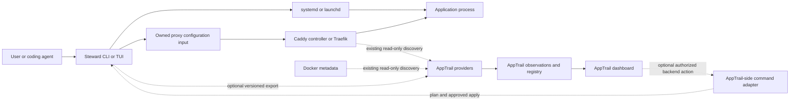

# Steward — Optional AppTrail integration

**Status:** proposed integration roadmap, not an implemented AppTrail API.  
**Related:** [architecture](02_ARCHITECTURE.md), [agent handoff](04_APPTRAIL_AGENT_HANDOFF.md), [repository decision template](templates/REPOSITORY_DECISION.md), [historical AppTrail PRD](reference/Apptrail_PRD.original.md).

## 1. Two products, two different authorities

Steward manages native service definitions and reverse-proxy routing intent. AppTrail discovers applications, reconciles observations, enriches metadata, and presents a customizable dashboard. The overlap is useful, but neither product must become a prerequisite for the other.

| Information or action | Authority |
|---|---|
| Owned service definition, startup intent, requested lifecycle changes | Steward, executed by the native service manager. |
| Owned route intent and approved configuration edits | Steward, activated by the proxy/controller. |
| Actual process/routing status | Native manager/proxy observations, not a stale desired-state record. |
| Dashboard app identity and observation reconciliation | AppTrail. |
| Dashboard display name, hidden state, favorites, grouping, layout | AppTrail user preferences. |
| External route or service definition | Its existing source; neither product obtains ownership by discovering it. |
| Correlation between a Steward resource and an AppTrail application | Explicit mapping or verified AppTrail reconciliation rules; not permission to modify either. |

A dashboard “hide” is not a route “disable.” A dashboard app can represent multiple services or routes. A worker service can have no URL at all. These distinctions are why a shared universal `Application` object is not required.

## 2. What is known, and what is not

The included **historical draft** establishes these design intentions, not current implementation facts:

| Historical AppTrail PRD reference | Relevant intention |
|---|---|
| Sections 1–5 | Discovery/dashboard focus; service orchestration and deployment excluded from its first release. |
| Sections 7–9 | Providers emit observations; reconciliation and enrichment produce dashboard records. |
| Section 10 | Explicit `apptrail.id` and normalized endpoint identity; preserve user overrides. |
| Section 12 | Optional application metadata at `/.well-known/apptrail.json`. |
| Section 14 | File provider accepting a proposed `version` / `apps` document. |
| Sections 19 and 21 | Suggested HTTP endpoints and connection configuration shapes. |
| Section 27 | Implementation language, Traefik reading strategy, authentication, and other decisions were still open. |

The receiving AppTrail agent must confirm what actually exists, with source paths, symbols, versions, and tests. Do not describe the draft's provider interface as a shipped Rust trait, its file example as a validated current schema, or its suggested endpoints as available write APIs. [A01]

The live code audit also determines whether AppTrail already reads native services, has durable external-resource identities, or can load a new observation source without refactoring. Those facts are currently unknown.

## 3. Interaction structure



Solid arrows describe runtime relationships in the proposed Steward use case. Dashed edges are discovery or optional integration paths, not required running components. “Existing discovery” is conditional on which providers the actual AppTrail implementation supports. The bridge can be a backend subprocess adapter; it does not imply a new Steward daemon.

## 4. Stage 0 — No direct integration

Use both products independently. Steward changes approved native inputs; AppTrail continues reading its configured Docker/proxy/file providers. Where those providers already observe the resulting routes, the dashboard can reflect them without Steward-specific code.

This is the lowest-coupling starting point. It preserves AppTrail's original discovery-first behavior and avoids a second source for facts it already sees. The audit must test actual observation coverage and refresh behavior rather than assuming all file-derived routes are visible to every existing AppTrail provider.

Limitations are acceptable and explicit: AppTrail may not know that Steward owns a route; a service with no URL may not fit a dashboard card; service lifecycle actions are not available through the dashboard; and native status may be unknown.

## 5. Stage 1 — Explicit read-only export

Add a Steward command that emits an intentionally small, versioned snapshot. A file export is sufficient initially. AppTrail is not permitted to edit Steward's state directory or read private operation backups.

There are two possible contracts; select the smallest one the current AppTrail code genuinely supports.

### 5.1 Existing AppTrail file-provider compatibility

If the audit proves its file-provider schema matches the earlier draft, Steward can offer an export adapter producing a compatible application list. Historical example shape, **not a certified current schema**:

```yaml
version: 1
apps:
  - id: api
    name: API
    url: https://api.example.com
```

Do not add undocumented fields to that format and assume AppTrail will accept them. If current AppTrail uses a different schema, the agent must document and test that exact schema. Export only appropriate launchable entries, omit secrets, and never convert a background worker into an invented URL.

Writing this file is an explicit export operation, with atomic replacement and a clear generated-file owner. It is not a second authoritative source of service/route intent. Without a running exporter or a later invocation, the file does not keep itself current.

### 5.2 Steward-native inventory contract

If provenance, status, and services without URLs require a richer contract, propose a small AppTrail-side reader instead of bending dashboard files into a control API.

Illustrative **new Steward-owned** schema:

```json
{
  "schema_version": "1",
  "host_id": "host_example",
  "scope": "user",
  "revision": "42",
  "observed_at": "2026-10-08T12:00:00Z",
  "complete": true,
  "sources": [
    {"id": "edge", "status": "ok", "observed_at": "2026-10-08T12:00:00Z"}
  ],
  "resources": [
    {
      "kind": "route",
      "id": "api-public",
      "ownership": "owned_definition",
      "desired": {"enabled": true},
      "observed": {"activation": "present", "upstream_health": "unknown"},
      "public_url": "https://api.example.com",
      "apptrail_id": "api"
    },
    {
      "kind": "service",
      "id": "api",
      "ownership": "owned_definition",
      "observed": {"running": "running"},
      "apptrail_id": "api"
    }
  ]
}
```

This is a draft exchange schema, separate from the desired-state manifests and the operation-result envelope. `revision` identifies Steward intent; `observed_at` and source status describe observation freshness. A later successful probe does not need to invent a new desired-state revision.

Before implementing deletion semantics, extend each source status with an explicit coverage boundary: which binding/resource kinds were requested, whether the snapshot was complete for them, and whether enumeration failed. Missing entries in a partial or stale snapshot must not mean deletion. A full successful inventory may mark a resource absent; AppTrail can still apply its own documented grace/stale/archive lifecycle.

The exact schema must be committed, versioned, validated, and tested on both sides. Host identity, scope, resource kind, and resource ID together form the external key. An optional `apptrail_id` is a correlation hint, not an authorization credential.

### Freshness without a mandatory daemon

A successful Steward mutation may optionally trigger an already configured export, but export failure must not be misreported as rollback of an otherwise successful infrastructure change. Record both outcomes.

Out-of-band service crashes, external proxy edits, and host reboots are not visible in a static export until another observation occurs. Options are AppTrail's existing polling, an explicit AppTrail-side call to a read-only Steward inventory command, or an operator-configured scheduled export. None should be silently installed as a background service.

## 6. Stage 2 — AppTrail-side read adapter

If users need fresh Steward-native observations, AppTrail's backend can invoke a read-only command such as the **proposed** `steward inventory --json`. This command is future integration scope, not a claim of an existing executable interface.

The adapter must use an explicitly configured executable path and argument vector, bounded execution time/output, schema validation, and a known host/scope. It must not construct shell commands from labels, dashboard titles, or URLs. Cache only the redacted observation result, with freshness and failure information.

Important deployment distinctions:

- A local AppTrail backend can invoke Steward only under the OS identity and permissions it actually has.
- An AppTrail container does not gain control of the host's launchd/systemd simply because it can read a shared export directory.
- A browser cannot invoke the host CLI directly; any such action belongs in an authenticated backend integration.
- Another machine needs an explicitly configured transport. Localhost always refers to the process's own network context; it is not a remote host selector.

Prefer file export for containerized dashboard deployments before introducing a privileged bridge. If remote inventory is later necessary, design its credentials, host binding, endpoint authentication, and trust boundary explicitly; do not expose a proxy admin API or arbitrary shell just to connect the dashboard.

## 7. Stage 3 — Optional management actions

Read-only integration ships before control. Control must be opt-in and limited to named actions/resources. AppTrail remains a presentation/requesting client; Steward continues enforcing ownership, current source fingerprints, capability checks, approval policy, journaling, and recovery.

A minimal local control flow is:

1. The authenticated AppTrail user requests a supported action on a known Steward resource.
2. AppTrail's backend passes a typed request to Steward and obtains a plan, effects, required approvals, and a short-lived plan identity/digest.
3. The UI displays the plan and receives the required confirmation.
4. The backend applies that exact plan through the authorized boundary.
5. Steward revalidates identity, scope, permissions, and native fingerprints before mutation and returns an operation receipt.
6. AppTrail refreshes observations; it does not assume the requested state is already the actual state.

The backend should call a small allowlisted CLI/stdio contract first when both apps share a host. A future local socket or secured remote API is an optional transport, not a reason to redesign the core as network microservices.

Do not offer arbitrary `exec`, accept user-supplied shell text as a management action, or turn AppTrail metadata into root commands. A privileged bridge needs its own authentication/authorization design, resource scoping, replay protection, bounded inputs, audit records, and OS privilege isolation. Browser-facing control also requires the AppTrail implementation's actual session/authentication and request-forgery protections. If these do not exist, control remains deferred.

Routine `--yes` approval is not authority to install a proxy, enable linger, change a Docker mount, or restart external infrastructure. The same setup boundary applies from the dashboard as from a coding agent.

## 8. Identity, duplicates, and preferences

Keep Steward IDs durable across process/container restarts. Do not merge resources solely because a container ID, display name, or port matches. A Steward route and an AppTrail observation of that route may correlate through an explicit mapping or a proven canonical endpoint/native source identity.

The historical AppTrail PRD intentionally distinguishes applications under different base paths and gives user preferences precedence. Preserve those principles when reconciling Steward observations. A route to `example.com/photos` and another to `example.com/notes` must not collapse merely because their hostname is the same. Steward's initial writable route subset is exact-host routing; discovered path-based observations still retain their original identity. [A01, section 10]

AppTrail's hidden/favorite/name/layout changes stay in AppTrail. Steward startup/enabled changes stay in Steward. Changes to one must not overwrite the other's fields during refresh. No shared database tables or direct cross-product writes are needed.

## 9. Shared repository is not an integration requirement

All stages above can work in separate repositories. A monorepo can still use the same versioned export/command boundary. Shared code is optional and should be limited to behavior the audit demonstrates is truly equivalent.

Examples worth evaluating are a small Docker connection helper, an unchanged native response decoder, or sanitized parser fixtures. Examples usually not worth forcing together are AppTrail's observation reconciler and Steward's desired-state planner, dashboard app records and service definitions, or a discovery provider interface and a privileged mutation adapter.

If an extraction requires broad schema conversion, new generic interfaces, UI dependencies in Steward, cross-language rewriting, or coordination of unrelated release cycles, the burden of proof is on that extraction. Duplicating a small stable helper may be less costly than maintaining an unnecessary shared abstraction.

## 10. Integration acceptance and rollout

Start with independent operation and prove that existing AppTrail providers see Steward-created routes. Add an export only when it supplies missing value. Add a reader only when freshness/provenance requires it. Add controls only after permission and plan/apply contracts are implemented and tested.

Required evidence: actual AppTrail schema/API/source references; round-trip sanitized fixtures; no duplicate/false merges; correct partial/stale handling; independent installation and operation; no secret leakage; no cross-product preference writes; and rejection of unauthorized or stale management requests. See tests A01–A08 in the [test plan](05_TESTING_AND_ACCEPTANCE.md).

The audit may conclude that no direct integration is necessary for the first releases. That is a valid result, not a missing feature.
